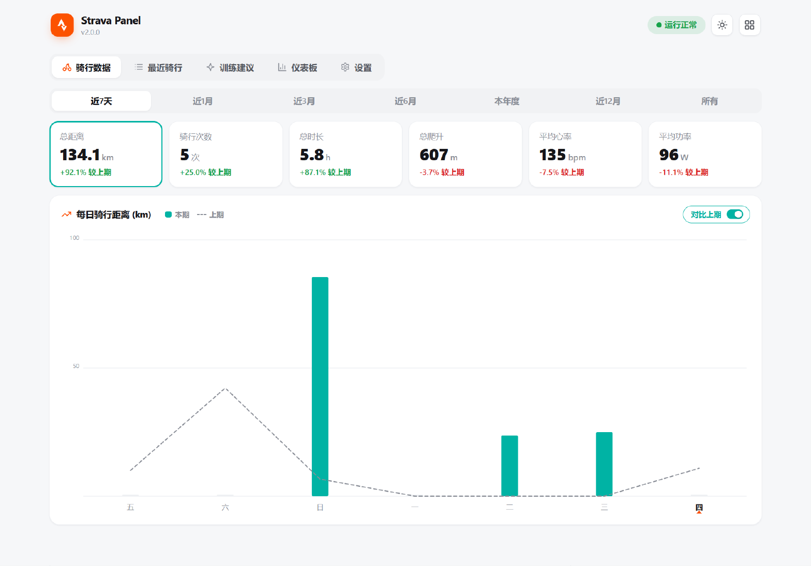

# Strava Panel

[](https://github.com/techysy/strava-panel/releases)
[](https://github.com/techysy/strava-panel/blob/main/LICENSE)
[](#全平台部署--multi-platform)
[](https://developers.strava.com/)

> Strava 骑行数据面板 — 凭据管理、Token 自动刷新、骑行统计可视化
>
> Strava cycling panel — credential management, auto token refresh, riding stats visualization

零依赖纯 Node.js 后端(ESM, Node ≥22.13, node:sqlite),一套代码多端部署:**飞牛 NAS (fnOS) / Docker / Windows·macOS·Linux 桌面托盘 / npm CLI**。

<p align="center">
  <picture>
    <source media="(prefers-color-scheme: dark)" srcset="docs/screenshots/home-dark.png">
    <source media="(prefers-color-scheme: light)" srcset="docs/screenshots/home-light.png">
    
  </picture>
  <br>
  <sub>骑行数据首页 · 统计卡即图表切换器 · 环比角标 · 对比上期虚线 · 日/夜主题自动适配 GitHub 模式</sub>
</p>

## 作者 / Author

洋芋 (YangYu) · 🚴 [Strava 主页](https://www.strava.com/athletes/121173304) · 🐂 [fnOS 应用系列](https://github.com/stars/techysy/lists/fnos-app)

---

## 功能 / Features

- 🧭 **顶部页签面板**：骑行数据（首页）/ 最近骑行 / 训练建议 / 仪表板 / 设置，日/夜主题自动适配系统，中英双语，官方 Strava 徽标 + 线性 SVG 图标
- 📊 **统计卡即图表切换器**：点「总距离 / 骑行次数 / 总时长 / 总爬升」任一张卡，趋势图随之切换指标；每张卡带「较上期」环比涨跌角标
- 📈 **对比上期**：一键叠加上一周期同粒度虚线，tooltip 同时显示本期/上期/涨跌幅；日视图星期字标 + 橙色「今天」指针（对齐官方）
- ❤️ **心率 / 功率**：自动采集平均/最大心率、平均功率、千卡消耗；最近骑行表逐条展示，区间均值卡片按数据自动显隐
- 🤖 **AI 训练建议教练**：接入 OpenAI 兼容 API（Ollama / LM Studio / vLLM / One-API 等本地网关），自动注入你的训练摘要（近 7/28/90 天 + 周趋势 + 最近 15 次）给出可执行计划；**多会话管理**控制上下文、**网关模型列表拉取**按供应商分组点选、会话级模型覆盖，对话记忆存本地 SQLite
- 🔄 **增量 / 全量双模式同步**：日常增量秒级（`after=` 水位只拉新），历史字段回填用全量重同步
- 📜 **日志控制台**：系统 / Strava API / Agent 三源分段切换，按日期归档查看、刷新、下载
- 🔑 **凭据管理**：Client ID / Secret 面板内配置（密钥打码 + 显隐），Refresh Token 经 OAuth 授权自动获取，6h 过期自动刷新
- 🗄️ **三组服务状态**：Strava API / 本地数据库 / Agent 外部调用，呼吸灯摘要徽章一眼定位异常
- 📤 **agent 透出接口**：本地 agent 直接 HTTP 查询，面板内一键复制 REST API 文档
- 🌐 **i18n**：中/英双语界面；🫧 状态反馈统一呼吸灯/圆点，无原生弹窗
- 🔒 **零依赖**：纯 Node.js 标准库（http + node:sqlite，Node ≥22.13），无第三方包

## 快速开始 / Quick Start

**安装渠道一览**(预构建产物均见 [Releases](https://github.com/techysy/strava-panel/releases)):

| 渠道 | 产物 / 命令 | 说明 |
|------|------------|------|
| fnOS fpk | `strava-x.x.x.fpk`(网页版,新标签页打开)、`strava-x.x.x-iframe.fpk`(窗口版,飞牛桌面窗口打开) | 飞牛 App Center → 手动安装 |
| Docker | `ghcr.io/techysy/strava-panel:latest`(amd64 / arm64) | `docker run` / compose |
| Windows | `StravaPanel Setup x.x.x.exe`(NSIS)/ `StravaPanel x.x.x.exe`(Portable) | NSIS 版支持应用内自动更新 |
| macOS | `StravaPanel-x.x.x-arm64.dmg` / `StravaPanel-x.x.x-x64.dmg`(zip 同) | 自动更新;未公证,首次右键打开 |
| npm CLI | `npm i -g @techysy/strava-panel`(`sp` 命令) | 系统 Node.js ≥22.13 即可 |

**fnOS (飞牛 NAS)**:

1. 从上表下载对应形态的 fpk(网页版或窗口版)
2. 飞牛 App Center → **手动安装** → 选择 fpk 文件(运行依赖应用商店的 **nodejs_v24** 应用,安装时会自动处理)
3. 打开 Strava Panel(端口 `20227`)
4. 在面板填入 Strava 凭据 → 保存并验证

**Docker**:

```bash
docker run -d --name strava-panel -p 20227:20227 -v strava-data:/data ghcr.io/techysy/strava-panel:latest
# 或 docker compose up -d
```

**Windows / macOS 桌面托盘版**(Electron,下载安装即用;自动更新内置):

从 Releases 下载对应平台的安装包。本地构建:

```powershell
cd desktop
.\build.ps1                # Windows: 打包 NSIS 安装包 + 便携版,产物在 desktop\dist
# macOS: cd desktop && npm i && npx electron-builder --mac
```

**npm CLI**(开发者/极客,系统 Node.js ≥22.13 即可):

```bash
npm i -g @techysy/strava-panel
sp start        # 后台启动 + 托盘;sp status / sp stop / sp open
```

> 各形态端口默认 `20227`,数据目录相互独立,可并存。凭据获取见下节。

### 获取 Strava 凭据 / Get Strava Credentials

1. 访问 [Strava My API Application](https://www.strava.com/settings/api) 查看 **Client ID** 和 **Client Secret**
2. 用下面链接授权获取 **Refresh Token**（需勾选 `activity:read_all`）：
   ```
   https://www.strava.com/oauth/authorize?client_id={你的ClientID}&response_type=code&redirect_uri=http://localhost&approval_prompt=force&scope=read,activity:read_all
   ```
3. 跳转后复制 `code=` 后面的值，在 [Strava token 交换](https://www.strava.com/oauth/token) 或用工具换取 refresh_token

## 端口 / Port

- **面板端口**：`20227`（高位不常见端口，降低被扫描探测风险）
- **访问地址**：桌面版/CLI 默认只绑 `127.0.0.1`(免防火墙弹窗),请用 `http://localhost:20227` 访问;fnOS/Docker 绑 `0.0.0.0` 供局域网访问。Strava 注册的 Callback Domain 需与你实际访问的域名一致(`localhost` / NAS IP 是两个不同域名,详见 [TROUBLESHOOTING §10](./TROUBLESHOOTING.md))

## 数据目录 / Data

- fnOS:凭据 + API token:`/vol4/@appdata/strava/strava.conf`(权限 600,仅应用用户可读);Token 缓存:`strava_tokens.json`;**SQLite 缓存**:`strava.db`(activities 表)
- Docker:全部在挂载卷 `/data`
- 桌面版/CLI:Windows `%APPDATA%\StravaPanel`;macOS `~/Library/Application Support/StravaPanel`;Linux `~/.strava-panel/data`
- **日志**（按源分开落库，历史按天归档到 `logs/`）：
  - `system.log` — 系统状态 / 初始化 / 本地 SQLite / 同步
  - `strava-api.log` — 请求 Strava API（token 刷新 / 活动拉取）
  - `agent.log` — agent 外部调用拿数据

## HTTP API（本地 agent 查询）

应用提供 REST API，本地 Hermes agent 或其他工具可直接查询（`http://localhost:20227`）。除 `/api/bootstrap` 和 `/api/status` 外，所有 `/api/*` 需 `Authorization: Bearer <api_token>`。

> 🔑 先拿 token（免认证）：`GET /api/bootstrap` → 返回 `{"api_token": ...}`，也可在面板「仪表板 → 创建 token」查看。

```bash
BASE="http://localhost:20227"
TOKEN=$(curl -s "$BASE/api/bootstrap" | node -e "let d='';process.stdin.on('data',c=>d+=c).on('end',()=>console.log(JSON.parse(d).api_token))")
AUTH="Authorization: Bearer $TOKEN"

# 服务状态（免认证）
curl -s "$BASE/api/status"

# 服务信息（含版本/端口/缓存数）
curl -s -H "$AUTH" "$BASE/api/info"

# 骑行统计（读缓存，快；可带日期范围）
curl -s -H "$AUTH" "$BASE/api/stats"
curl -s -H "$AUTH" "$BASE/api/stats?start=2026-07-01&end=2026-07-31"   # 按月

# 活动列表（支持过滤）
curl -s -H "$AUTH" "$BASE/api/activities?type=Ride&limit=10"
curl -s -H "$AUTH" "$BASE/api/activities?start=2026-07-01"

# 每周聚合
curl -s -H "$AUTH" "$BASE/api/weekly"

# 手动同步 Strava→SQLite
curl -s -X POST -H "$AUTH" "$BASE/api/sync"

# 导出全量数据（给 agent）
curl -s -H "$AUTH" "$BASE/api/export?fmt=json"
curl -s -H "$AUTH" "$BASE/api/export?fmt=csv" -o strava.csv

# 日志控制台
curl -s -H "$AUTH" "$BASE/api/logs/list?source=strava"
curl -s -H "$AUTH" "$BASE/api/logs?source=strava&tail=200"
curl -s -H "$AUTH" -o strava.log "$BASE/api/logs/download?source=strava"

# token 管理
curl -s -H "$AUTH" "$BASE/api/token/view"
curl -s -X POST -H "$AUTH" -H "Content-Type: application/json" -d "{}" "$BASE/api/token/recreate"

# API 使用指南（Markdown）
curl -s -H "$AUTH" "$BASE/api/doc?lang=zh"
```

> 💡 面板「设置 → API」可一键复制完整 API 指南；agent 用法示例：`curl -s -H "$AUTH" "$BASE/api/stats?start=2026-07-01&end=2026-07-31" | jq '.total_distance_km'`（无 jq 可省略管道直接看 JSON）

## 构建 / Build

### fnOS fpk

fnOS 打包工程在 `fnos-packaging/` 目录(布局与 10Router 一致):核心源码 `server/` + `www/` 在仓库根,打包时拷入 `fnos-packaging/app/`。

```bash
# 本地(在 fnOS 或装有 fnpack 的 Linux 上,仓库根执行)
bash scripts/build.sh                  # 默认网页版(url),产物 strava-<ver>.fpk
bash scripts/build.sh --variant iframe # 窗口版,产物 strava-<ver>-iframe.fpk

# CI(推荐)
# 推 tag v* 或手动触发 .github/workflows/build-fpk.yml,
# 网页版 + 窗口版 双 fpk + SHA256SUMS-fpk.txt 自动挂到 GitHub Release
```

### 图标 / Icons

图标用 `scripts/generate-icons.py` 生成 —— 按 Strava 官方 SVG 徽标路径矢量绘制(橙色圆角方块 + 白色 echelon),任意分辨率无损,一次产出 fnOS / 桌面 / CLI 全部图标:

```bash
python3 scripts/generate-icons.py
```

### Docker

```bash
docker build -t techysy/strava-panel .
docker run -d --name strava-panel -p 20227:20227 -v strava-data:/data techysy/strava-panel
```

镜像基于 `node:24-alpine`,零 npm 依赖,带 HEALTHCHECK。数据(凭据/token/SQLite)全部持久化在 `/data` 卷。

### 桌面托盘版(Electron)

`desktop/` 目录,架构:Electron 托盘壳 + Node.js 后端(复用 Electron 内嵌 Node,零外部运行时):

```powershell
cd desktop
npm i
npx electron-builder --win          # 产物 desktop\dist\: StravaPanel Setup x.x.x.exe(NSIS)+ Portable 便携版
# macOS: npx electron-builder --mac
```

- 托盘菜单:打开面板 / 启动·停止·重启服务 / 开机自启 / 打开数据目录·日志
- 点关闭缩到托盘;单实例锁;端口已被占用时自动识别为外部服务直接开窗
- **Windows + macOS 双平台**:CI 推 tag 自动产出 NSIS/Portable(win)与 dmg/zip x64+arm64(mac),并接入 electron-updater 自动更新;mac 本地构建:`cd desktop && npm i && npx electron-builder --mac --x64 --arm64`
- Linux:`npx electron-builder --linux` 需在 Linux 平台执行

### npm CLI

`cli/` 目录,发布为 `@techysy/strava-panel`(`sp` 命令):

```bash
cd cli
npm run build          # 汇集 app/server + app/www 到 cli/app
npm publish            # prepublishOnly 自动构建
```

零依赖优势:无需 venv/pip,系统 Node.js ≥22.13(node:sqlite)直接跑。Windows 托盘用 PowerShell NotifyIcon(零二进制依赖),macOS/Linux 用 systray2(惰性安装)。

### 服务端环境变量

| 变量 | 默认 | 说明 |
|------|------|------|
| `SP_PORT` / `PORT` | `20227` | 监听端口(SP_ 优先) |
| `SP_HOST` | `0.0.0.0` | 绑定地址(桌面壳可设 127.0.0.1) |
| `SP_DATA_DIR` / `DATA_DIR` | `/tmp/strava-data` | 数据目录(SP_ 优先) |

## 问题排查 / Troubleshooting

常见问题快速索引（详细排障见 [TROUBLESHOOTING.md](./TROUBLESHOOTING.md)）：

| 现象 | 快速解决 |
|------|---------|
| 桌面图标打不开 | 确认应用在 App Center 里是启用/运行状态，端口为 20227 |
| `Unexpected token '<'` | 旧进程占端口，杀残留后重启应用 |
| `EADDRINUSE` / `Address already in use` | `pkill -9 -f "strava/server/app.js"` 清理残留 |
| Strava 401 权限缺失 | 重新授权并勾选 `activity:read_all` |
| 数据不更新 | 面板「立即同步」或 `curl /api/sync` |

## 相关链接 / Links

- [9Router](https://github.com/techysy/9router-fnos) — Hermes 相关 fnOS 应用（AI 路由器 / API 代理）
- [MetaCubeXD](https://github.com/techysy/metacubexd-fnos) — Hermes 相关 fnOS 应用（Mihomo 网络代理面板）
- [Hermes WebUI](https://github.com/techysy/hermes-webui-fnos) — Hermes 相关 fnOS 应用（WebUI 浏览器访问）
- [fnOS 开发者文档](https://developer.fnnas.com/docs/guide)

## License

MIT
